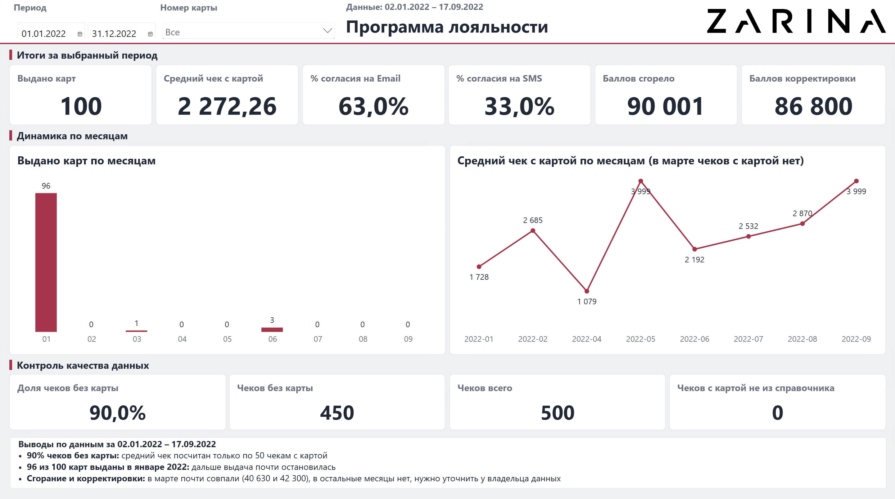
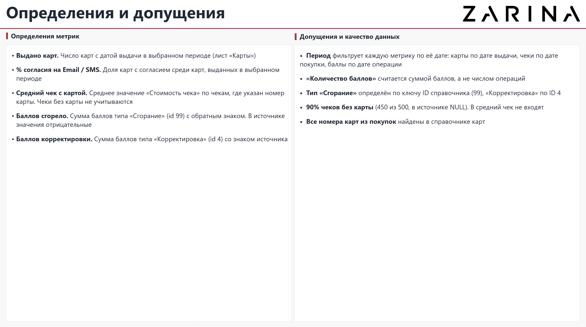

# тест задание

- `task1/solution.sql` запрос, `task1/result_cards.csv` результат
- `task2/Zarina.pbix` отчёт
- `docs/` модель, меры, качество данных,допущения
- `task1/conditions`, `task2/conditions`исходные файлы

## задание 1

нашёл 8 карт из 39: 899910007, 899910009, 899910013, 899910018, 899910019, 899910031, 899910032, 899910035
[tut csv](task1/result_cards.csv)
[tut sql](task1/solution.sql)

в журнале одна строка - одна позиция чека, => сворачиваю до чека => ID_CARD = ID_CARD , ID_KASSA = ID_KASSA => + прошло не больше 10 минут
чек 8001610 есть у двух разных карт, на результат не влияет

## задание 2

модель: два факта (покупки, бонусы) и справочники карт, типов транзакций и календаря. связь карт с календарём по дате выдачи неактивная (в мерах `USERELATIONSHIP` (подробнее [model.md](docs/model.md))

две страницы: дашборд и страница с определениями. фильтры по периоду и номеру карты действуют на все метрик (данные с 02.01.2022 по 17.09.2022)

| метрика | значение |
|---|---|
| выдано карт | 100 |
| средний чек с картой | 2 272,26 |
| % согласия на Email | 63,0% |
| % согласия на SMS | 33,0% |
| баллов сгорело | 90 001 |
| баллов корректировки | 86 800 |

что видно в данных:

1. в 450 чеках из 500 нет номера карты, => средний чек по 50 чекам, а в некоторые месяцы по одному-двум. его динамике верить нельзя
2. 96 карт из 100 выданы в январе 2022, последняя в июне
3. Email есть у 63% карт, SMS у 33%, main - почта
4. начислено 22 720 баллов, сгорело 90 001, корректировок на +86 800, в марте сгорание и корректировки почти совпали (40 630 и 42 300), в остальные месяцы нет, нужно уточнить у владельца данных
