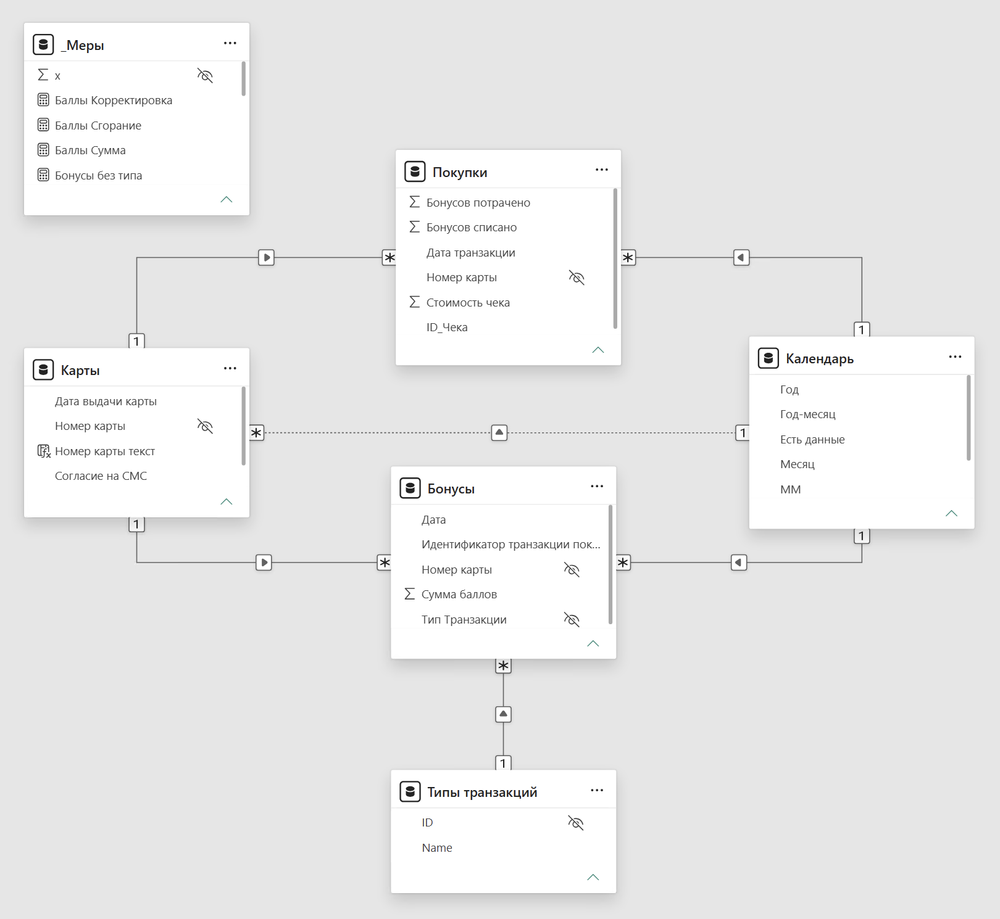

# модель и меры

два факта (покупки, бонусы), справочники карты, типы транзакций и календарь, плюс таблица `_Меры` для мер



все связи один ко многим от справочника к факту 
связь Карты -> Календарь по дате выдачи неактивная: календарь фильтрует и покупки с бонусами, и карты, а карты фильтруют покупки и бонусы, и с тремя активными связями получается два пути до бонусов. поэтому в мерах про карты связь включается через `USERELATIONSHIP`

календарь на `CALENDARAUTO()`, колонка «Есть данные» отсекает пустые месяцы на графиках

в Power Query: `NULL` в номере карты заменяется на пустое, даты приводятся к типу «дата», у заголовка «Согласие на СМС» убран пробел в конце

## меры
```dax
Карты Выданные =
CALCULATE (
    COUNTROWS ( Карты ),
    USERELATIONSHIP ( Карты[Дата выдачи карты], Календарь[Date] )
) + 0

Карты с Email = CALCULATE ( [Карты Выданные], Карты[Согласие на Email] = 1 )
Карты с SMS   = CALCULATE ( [Карты Выданные], Карты[Согласие на СМС] = 1 )

Email согласие % = DIVIDE ( [Карты с Email], [Карты Выданные] )
SMS согласие %   = DIVIDE ( [Карты с SMS], [Карты Выданные] )

Чеки Всего    = COUNTROWS ( Покупки )
Чеки Сумма    = SUM ( Покупки[Стоимость чека] )
Чеки с картой = CALCULATE ( [Чеки Всего], NOT ISBLANK ( Покупки[Номер карты] ) )

Чек средний с картой =
DIVIDE (
    CALCULATE ( [Чеки Сумма], NOT ISBLANK ( Покупки[Номер карты] ) ),
    [Чеки с картой]
)

Баллы Сумма = SUM ( Бонусы[Сумма баллов] )

Баллы Сгорание     = - CALCULATE ( [Баллы Сумма], 'Типы транзакций'[ID] = 99 )
Баллы Корректировка = CALCULATE ( [Баллы Сумма], 'Типы транзакций'[ID] = 4 )
```

`Баллы Сумма` и `Чеки Всего` базовые меры, остальные ссылаются на них. 
тип операции ID,сгорание в источнике со знаком минус, знак  на обратный

`+ 0` в Карты Выданные, чтобы в месяцах без выдачи было 0, а не пусто

`Период данных`,чтобы шапку не нужно править руками

в календаре столбец `ММ` , он нужен для оси графика выдачи карт

в Карты есть столбец `Номер карты текст` для слайсера ибо поиск в слайсере работает только по тексту

для блока контроля качества есть ещё меры: Чеки без карты, Чеки без карты %, Чеки с картой вне справочника (должно быть 0), Бонусы без типа, Чеки без даты
